# GenPay evaluator presentation flow

A second presentation flow for an evaluator, prepared on 14 October 2026.
Assumed duration: 20 minutes, followed by questions. If the evaluator gives a rubric, use its wording for your objectives and evidence.

## 1. How to present to an evaluator

Organize the demonstration around the questions an evaluator needs answered:

1. What problem does the system address?
2. Who uses it, and what can each role do?
3. Can a complete transaction succeed?
4. Does a relevant invalid action get blocked?
5. Can the result be traced and reconciled?

For each demonstration, follow the same speaking pattern:

**Purpose → action → visible result → evidence.**

Example:

> This feature lets Finance load a student's wallet. I will load ₱200 into the selected student's account. The confirmation shows ₱200 credited and ₱2 added as the current service fee. After confirming, we can see both the updated student balance and the transaction reference in Finance history.

Pause on the result screen so the evaluator can inspect it. State what happened before moving to the next role.

The presentation story is one campus transaction, with account setup and one controlled failure to show validation.

```mermaid
flowchart LR
    A[Problem and objectives] --> B[Roles and access]
    B --> C[Account import validation]
    C --> D[Merchant onboarding and inventory]
    D --> E[Finance wallet loading]
    E --> F[Student payment and receipt]
    F --> G[Parent allowance and controls]
    G --> H[Blocked action and restored access]
    H --> I[Student transfer]
    I --> J[Merchant payout]
    J --> K[Ledger, reconciliation, and audit]
    K --> L[Evidence-based closing]
```

## 2. Before the evaluator arrives

Use the same fictional student and merchant throughout. Prepare these records on the presentation installation:

| Item | Preparation |
| --- | --- |
| Finance | Active account; super-admin if showing Audit Log |
| Merchant | Active owner/admin account, approved stall, wallet, and demo lease |
| Student A | Active account and wallet; enrolled where required; unfrozen |
| Student B | Valid eligible transfer recipient, known school ID |
| Parent | Linked to Student A, separate wallet with at least ₱100 |
| Product | Available and allowed, priced at ₱60, at least 5 in stock |
| Cashier Vault | Enough value for a ₱200 student load |
| Application | Prepared fictional application and an awarded outcome |
| Import examples | Correct signed template plus a known invalid template |
| Baselines | Initial balances, product stock, and circulation cap recorded |
| Fallback evidence | Labelled rehearsal screenshots of successful outcomes |

Read the live transfer minimum, daily transfer limit, and student spending limit. Use ₱20 for the transfer only if it fits those limits. Do not use accounts whose suspension, graduation, or enrollment state would block the intended demo.

If you use Liam Pascual's recently reset account, complete its required password change before the timed presentation, unless that screen is intentionally part of the demonstration. Do not display the password.

Keep each role in a different browser profile or browser. Multiple tabs in one profile share the PHP session. Test the student phone's actual server URL, camera permissions, QR loading, and network access. A phone's localhost is not the projector computer.

Prepare a walk-in POS code fallback. The current **Enter POS code** option works for the merchant's walk-in POS bill. Product-scanning self-service orders use a different payment flow.

Complete one rehearsal and write down the actual results. This document supplies expected behavior from code inspection, not completed live-test results.

## 3. Twenty-minute sequence

| Time | Step | Main evidence |
| --- | --- | --- |
| 0:00–1:00 | Introduce problem and objectives | Clear purpose and bounded scope |
| 1:00–2:00 | Roles and login | Assigned portal and role-specific navigation |
| 2:00–4:00 | Account import and validation | Correct preview and invalid-template rejection |
| 4:00–5:00 | Merchant application and approval | Contract/payment prerequisites and awarded record |
| 5:00–6:00 | Merchant inventory | Allowed item, price, stock, availability |
| 6:00–8:00 | Finance wallet load | Fee breakdown, reference, increased student balance |
| 8:00–11:00 | Student purchase | Paid bill, receipt, wallet changes, reduced stock |
| 11:00–14:00 | Parent allowance and control | Allowance record and frozen-wallet refusal |
| 14:00–15:00 | Student transfer | Successful transfer after restoring the wallet |
| 15:00–17:00 | Merchant encashment | Pending request followed by Finance release |
| 17:00–19:00 | Finance verification | Ledger reference, economy pools, relevant audit event |
| 19:00–20:00 | Conclude and invite questions | Objectives tied to demonstrated results |

### Step 1. Introduce the problem and objectives

**Show:** title slide or public landing page, /index.php.

**Say:**

> Good day. We are presenting GenPay, a campus cashless payment system for General de Jesus College. Our project addresses campus payment handling, transaction records, parent supervision, and merchant reconciliation. We will demonstrate how these roles work together, show one blocked action, and verify the resulting records.

Briefly give the objectives:
- support wallet loading and campus purchases;
- provide merchant inventory and sales records;
- allow linked parents to send allowance and supervise spending;
- let Finance trace cash operations and wallet value.

Explain why those objectives matter using your own research. Avoid unmeasured claims about reduced queues or increased security.

**Transition:**

> We will begin with who can access the system and how accounts are prepared.

### Step 2. Explain the roles and login

**Show:** /login.php and the prepared Finance Dashboard.

**Do:**
1. Point out **Email or Student ID** and sign-in.
2. Show the portal assigned to the account.
3. Briefly introduce Finance, Merchant, Student, and Parent.
4. Mention that merchant staff have reduced operational navigation.

**Say:**

> GenPay has a shared login page. Each account receives its assigned portal: Finance manages the school records and cash operations, merchants handle products and sales, students pay and transfer, and parents manage their own wallet and supervise linked students.

Student registration and password recovery are assisted by Finance. Temporary passwords must be changed when required.

**Evidence to pause on:** the assigned role's dashboard and sidebar.

### Step 3. Show account provisioning and input validation

**Show:** Finance **Maintenance → Bulk Student Import**, /admin/maintenance.php.

**Do:**
1. Show the current **Download Template** option.
2. Preview the valid demo CSV and explain total, ready, duplicate, and error counts.
3. Point out a previewed student record without exposing real personal information.
4. Clear the preview and preview one invalid template.
5. Show the rejection message.
6. Clear the preview again and return to the prepared student account.

Use demo_csv/01_students_valid_batch_a.csv for the valid example and 05_students_wrong_template_renamed_columns.csv for an invalid example, provided the signing marker belongs to this installation. If the valid records were imported during practice, explain their duplicate result or prepare a fresh signed template with fictional unused IDs.

**Say:**

> Finance provisions accounts through an import preview. The system checks the downloaded template and student details before creating accounts. Here is a correct file's preview, and here is a file rejected because its column names were changed.

**Evidence to pause on:** a ready/duplicate preview and an explicit invalid-template refusal.

The timed version shows preview and validation. Show actual account creation only on the rehearsed demo installation, then confirm the created record under **Users**. Student-account import differs from the School Years enrollment roster.

**Transition:**

> The other preparation step is approving the merchant that will receive the payment.

### Step 4. Explain merchant onboarding

**Show:** public **Stall Directory**, /stalls.php, then Finance **Stall Applications**, /admin/stall_applications.php.

**Do:**
1. Open the prepared application.
2. Show its meeting, submitted documents, signed contract, deposit/advance, and stall assignment.
3. Show an existing awarded record and resulting merchant/lease details.

**Say:**

> Applicants submit business details and required documents. Finance reviews these in the scheduled meeting, records the contract and initial payment, and awards an available stall. Awarding creates the merchant account, wallet, and lease.

**Evidence to pause on:** prerequisites and awarded outcome.

Use a prepared record for the one-minute segment. A full live application requires additional time and can queue external email; the credential-email delivery should be claimed only if separately verified.

### Step 5. Show the product and its business rules

**Show:** Merchant **Inventory**, /merchant/inventory.php.

**Do:**
1. Locate the ₱60 demo product.
2. Show stock, price, availability, and its product QR.
3. Mention that restricted or unavailable products cannot be used for an eligible sale.
4. Open Merchant **POS**, /merchant/pos.php.

**Say:**

> The merchant maintains the catalog used in checkout. We will buy one unit of this allowed, available item. Its starting stock is [actual value], so we can verify the change after payment.

**Evidence to pause on:** price and recorded starting stock.

Avoid repeatedly attempting restricted products during the main demo: the configured strike policy can suspend the merchant.

### Step 6. Demonstrate Finance wallet loading

**Show:** Finance **Cash Management**, /admin/cash_management.php.

**Do:**
1. Click **Send GenCoin** and select **Student**.
2. Enter Student A's school ID and verify identity.
3. Enter ₱200.
4. Explain the confirmation: ₱200 wallet credit, ₱2 Finance fee, ₱202 collected under the current 1% rate.
5. Simulate receipt of cash, confirm once, and show the success reference.
6. Show **Recent Top-up History**.
7. Refresh Student Dashboard and show the ₱200 increase.

**Say:**

> The requested amount is credited in full. The service fee is added on top. Finance moves existing points from the Cashier Vault into the student's wallet, and the transaction is recorded.

**Evidence to pause on:** confirmation, reference, and before/after student balance.

Use the displayed amounts if rates change before evaluation. GenCoin conversion is currently ₱10 = 1 GC, so ₱200 corresponds to 20 GC.

### Step 7. Demonstrate purchase and verify its effects

**Show:** Merchant POS and Student **Shop Cart**, /student/cart.php.

**Do:**
1. As merchant owner, add one ₱60 product to **Walk-in Order**.
2. Show the total and click **Generate Payment QR**.
3. Explain the pending state: bill creation has not yet deducted money.
4. Student scans the payment QR. If needed, choose **Enter POS code**, enter the merchant's displayed code, and click **Check Bill**.
5. Show merchant, items, and amount in the confirmation.
6. Confirm payment once.
7. Show the merchant bill as paid.
8. Open Student **History** and its transaction detail.
9. Refresh inventory to show stock reduced by one.
10. Verify student decreased by ₱60 and merchant increased by ₱60.

**Say:**

> Payment requires the student's confirmation. Once it succeeds, the student is debited, the merchant is credited, stock decreases, and the receipt records the purchase. We can inspect the same reference in Finance later.

**Evidence to pause on:** paid status and itemized transaction record.

Run this with the merchant owner account. Staff-created sales have a separate remittance reporting step.

**Transition:**

> We have shown a successful payment. Next, we will show parent support and a controlled refusal.

### Step 8. Show parent allowance and prove a control is enforced

**Show:** Parent Dashboard, **Send Allowance**, **Activity Trail**, and the linked student's **Manage Controls**.

**Do:**
1. Show the parent's separate wallet and linked Student A.
2. Explain that self-service linking needs approval from Student **Profile**. Use an already-established link for this timed sequence.
3. Send ₱50 through /parent/allowance.php.
4. Show the allowance reference, parent decrease of ₱50, and student increase of ₱50.
5. On /parent/activity.php, show the linked student's purchase and allowance using the relevant filters.
6. Open the linked student's ledger → **Manage Controls** → **Freeze Wallet**.
7. On Student **Send GenCoin**, try a small otherwise-valid transfer to Student B.
8. Show the frozen-wallet refusal and confirm that balances did not move.
9. Return to the parent and unfreeze the wallet.
10. Mention daily spending limits and low-balance alert settings.

**Say:**

> The parent sends allowance from their own wallet and can inspect linked student activity. The freeze control is enforced when the student tries to spend or transfer. This attempt is refused, and the balances stay unchanged. We will now restore access.

**Evidence to pause on:** allowance reference, frozen status, refusal message, unchanged balances.

Choose the failed transfer amount and recipient in rehearsal so unrelated limits do not cause the refusal. Restore the freeze before the next step. If the prepared account is already linked, do not submit a duplicate link request just to explain consent.

### Step 9. Show a successful student transfer

**Show:** Student **Send GenCoin**, /student/transfer.php.

**Do:**
1. Refresh after unfreezing.
2. Enter Student B's school ID and ₱20, or the rehearsed permitted amount.
3. Verify the recipient and confirm once.
4. Show the reference and the corresponding sender/recipient balance changes.

**Say:**

> After access is restored, the same eligible student can transfer value to another eligible student. The sender decreases and the recipient increases by the same amount.

**Evidence to pause on:** successful transfer after the previous controlled failure.

This confirms a control can be restored as well as applied. It does not replace broader validation or security testing.

### Step 10. Complete merchant payout

**Show:** Merchant **Encash**, /merchant/encash.php → Finance **Cash Management**.

**Do:**
1. As merchant owner, request ₱40.
2. Show the request as **pending**. The request itself does not release the funds.
3. Finance verifies the merchant and amount.
4. Simulate handing over cash and click **Release** once.
5. Show released status and settlement reference.
6. Refresh balances: merchant decreases by ₱40; vault increases by ₱40.

**Say:**

> The merchant requests a payout and Finance records its release. The digital value returns to the vault when the merchant balance is settled.

**Evidence to pause on:** released request and balance changes.

### Step 11. Verify records and show school oversight

**Show:** Finance **Transactions**, **Economy**, and super-admin **Audit Log**.

**Do:**
1. Search the purchase reference on /admin/transactions.php and open details.
2. Match merchant, student, amount, and items to the demonstrated sale.
3. Show the cash-in or payout record if time allows; mention CSV export.
4. Open /admin/economy.php and show vault, student, merchant, and parent pools with the actual balance indicator.
5. With super-admin, locate a relevant event in /admin/audit_log.php.
6. Briefly identify the supporting modules on a single slide: Users, Maintenance, School Years, Leases & Rent, Admin Wallet, and Settings.

**Say:**

> The purchase is traceable by reference. The Economy view compares the circulation cap with the vault and all wallet groups. The audit trail records administrative activity separately from the financial ledger.

**Evidence to pause on:** matching purchase reference and actual reconciliation result.

Ordinary purchases, transfers, allowance, and payout redistribute value. Explicit minting and fee-waiver credits can increase circulation cap. Show an audit event only if it exists in the running environment; audit configuration is not established by source inspection.

Keep technical architecture on a backup slide if time is tight: **Browser → PHP pages/endpoints → shared logic → MySQL via PDO**, with separate audit writing and queued email.

### Step 12. Close using the demonstrated objectives

**Show:** a short summary slide.

**Say:**

> We demonstrated account validation, merchant setup, wallet loading, a completed purchase and receipt, parent allowance and an enforced freeze, student transfer, and merchant payout. We then traced the purchase through Finance records and inspected the economy. These results show how the roles work together around campus payments and oversight. Thank you. We are ready for your questions.

Use the successful results from the actual demo. If a step failed, acknowledge it and distinguish a prepared screenshot from a live result.

## 4. Expected balance cue card

If Student A and the merchant start at zero, and the parent starts at ₱100:

| Point in demo | Student A | Parent | Merchant |
| --- | --- | --- | --- |
| Start | ₱0 | ₱100 | ₱0 |
| After ₱200 Finance load | ₱200 | ₱100 | ₱0 |
| After ₱60 purchase | ₱140 | ₱100 | ₱60 |
| After ₱50 allowance | ₱190 | ₱50 | ₱60 |
| After frozen transfer attempt | ₱190 | ₱50 | ₱60 |
| After successful ₱20 transfer | ₱170 | ₱50 | ₱60 |
| After ₱40 payout | ₱170 | ₱50 | ₱20 |

Student B increases by ₱20 only in the successful transfer. Product stock decreases by one only on the completed purchase. Finance collects ₱202 for the ₱200 load at the current rate.

If baselines or transfer amount differ, write your own before/after values. Maintenance fees are separate tuition-billed entries; they are not the same as the top-up fee.

## 5. Supporting modules: answer or extend when asked

The main flow covers the connected transaction. Use prepared records to show these other capabilities:

| Module | Demonstration path | What the evaluator can inspect |
| --- | --- | --- |
| Tenant directory | Finance Dashboard → merchant details | Stall, proprietor, documents, staff, compliance |
| Rent and lease | Finance Leases & Rent → lease details → Merchant Rent & Lease | Monthly ledger and recorded rent receipt |
| School years | Finance School Years | Active year, roster/status tools, balance archives; activation preserves wallet value while changing eligibility |
| Fee-waiver credits | Maintenance → Fee Waiver Credits; student Profile | Amount, signed-waiver posting, claim reference |
| Fee-waiver import | Maintenance → Fee Waiver Import preview | Direct credit of eligible existing students; different from account creation and manual waiver/claim |
| Maintenance fees | Admin Wallet; Settings | Student fee entries, configured rate, tuition-billing/collection status |
| Restricted products | Maintenance → Restricted Products; Merchant Inventory | Exact/contains rule and restriction result |
| Merchant staff | Staff → prepared staff account → staff portal | Reduced navigation, owner-linked resources, Remit Sales report |
| Self-service shopping | Inventory product QR → Student Shop Cart → Submit Order → merchant queue → order payment QR | Pre-order visible before payment, paid reference and stock update |
| Parent shopping | Parent Shop Cart | Purchase uses parent's own wallet |
| Unpaid cancellation | POS queue → Void order → Voided Transactions | Unpaid order cancelled without a refund |
| Completed return | Sales History → Issue Return | Eligible student sale marked reversed with a new refund entry |
| Merchant wallet loading | POS → Send GenCoin | Merchant-funded recipient load; current 1% school + 2% merchant fee added on top |
| Profiles/documents | Role Profile/Security; Merchant Business Profile | Personal details, password changes, public listing and compliance documents |
| Policy settings | Finance Settings | Money limits, mint PIN, strike policy, waiver ceiling, maintenance fee |
| Privileged minting | Economy using super-admin | Required reason, monthly soft/hard limits, PIN verification above soft limit |

Do a paid return before cashing out the merchant balance needed to fund it. The current return endpoint expects a student wallet; do not promise parent-payment returns. Staff remittance confirms staff sales for reporting; it does not make a second customer payment.

Account-import sample emails use example.com and cannot show actual email receipt. The restricted-product CSV is manual reference material, not an import feature. The student-account CSV and school-year roster are different templates.

Live school-year activation, fee crediting, and minting change eligibility or money supply. Use prepared outcomes or previews unless those actions are included in your rehearsed demo setup.

## 6. Team handoffs and slide order

For a three-person team:

| Presenter | Responsibility | Handoff line |
| --- | --- | --- |
| Presenter 1 | Problem, roles, imports, merchant onboarding | “With the accounts and merchant prepared, we will demonstrate the payment.” |
| Presenter 2 | Inventory, loading, payment, parent controls, transfer | “We have seen the customer side. We will now close the merchant and Finance records.” |
| Presenter 3 | Payout, ledger, economy, conclusion; technical questions | “The reference and balance changes connect the transaction across the system.” |

Use one projector operator and a second person on the student device. Speakers should not have to type every demonstration input.

Suggested slides:
1. Title and team.
2. Problem and objectives.
3. Four roles and system scope.
4. End-to-end demo diagram.
5. Supporting school/merchant modules.
6. Demonstrated results and conclusion.
7. Backup: architecture, actual tests, limitations, and panel answers.

## 7. Evaluator questions and answer discipline

| Likely question | Answer |
| --- | --- |
| Why is the system needed? | Explain the identified school problems and cite your project's actual research findings. |
| What proves the payment worked? | Paid status, reference, receipt/items, wallet changes, and stock change. |
| What happens when access is restricted? | Show the rehearsed frozen-wallet refusal and unchanged balances, then restore access. |
| Can a parent link any student? | Self-service linking requires student approval. Finance import can provision guardian links separately. |
| Does a parent purchase charge the student? | No; the parent has a separate wallet. Allowance moves value to the linked student. |
| Is GenCoin cryptocurrency? | It is this application's display conversion of peso-denominated campus wallet value, currently ₱10 per GC. |
| Does creating an order deduct funds? | No; payment confirmation is a separate step. |
| How do students register or recover a password? | Finance-assisted provisioning and reset; the public login links explain office assistance. |
| What fees apply? | Current Finance loading adds 1%. Merchant loading adds 1% school plus 2% merchant. Maintenance fees are separate and configurable. |
| What changes total supply? | Authorized minting and fee-waiver credits; ordinary wallet movement redistributes value. |
| What can only super-admin do? | Examples include explicit minting and Audit Log access. Minting requires a reason; current monthly soft/hard limits are ₱50,000/₱500,000. |
| Is bank/GCash settlement implemented? | Describe the school cash handling and recorded receipts shown. Do not claim an external payment-gateway integration. |
| Does it work offline? | It needs access to the application server/database. Some QR, interface, and email functions use external services. |
| How secure or scalable is it? | Describe the implemented safeguards and show test results you actually obtained. Avoid claims of complete security or measured capacity without evidence. |

For an unexpected question:
1. Answer the specific question in one sentence.
2. Show the relevant screen, result, or implementation evidence.
3. State any verified limit.
4. If it was not tested, say so clearly.

## 8. Final rehearsal and fallback

- Confirm the actual app URL, database, and isolated role sessions.
- Finish first-login password changes before starting the timer.
- Confirm student eligibility, balances, parent link, stock, and limits.
- Verify the import templates match the presentation installation.
- Test QR scanning and the walk-in POS code fallback.
- Practice the freeze refusal, unfreeze, and successful transfer in order.
- Verify payout and reconciliation without submitting duplicate actions.
- Check audit availability and email delivery before making claims about them.
- Prepare labelled screenshots and the before/after balance cue card.
- Run the sequence within 20 minutes and rehearse the handoffs.

If camera access fails, use the walk-in payment code. If a payment times out, inspect order status and history before retrying. If the server is unavailable, use labelled rehearsal screenshots and tell the evaluator what is being shown.

For a 10-minute slot, keep purpose/roles (1 minute), prepared account validation/setup (1), wallet load (1), purchase/evidence (3), parent control (1), payout (1), ledger/economy (1), conclusion (1). Leave the successful transfer and supporting modules for questions.

This second flow draws on the existing source scan and the original PRESENTATION_FLOW.md. Screen labels for imports, Shop Cart, POS, and parent controls were checked again. No live transaction, freeze, account import, payout, or application test was performed while preparing this document.
