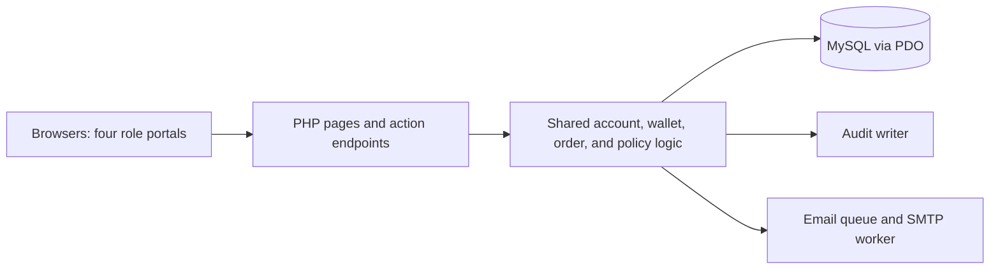

# GenPay presentation flow and rehearsal guide

Prepared from the repository on 14 October 2026. Assumed audience: an academic evaluation panel. Main demonstration: 20 minutes, with questions afterward.

This guide describes the current code. It does not establish that a live presentation has passed rehearsal. Check the actual presentation machine, database, browser, camera, and email environment beforehand.

## 1. Presentation story

Follow one student’s purchase through all four portals. Introduce each module when the audience needs it.

**Flow:** Campus problem → users and access → merchant onboarding → inventory → wallet loading → purchase → receipt and stock update → parent supervision → student transfer → merchant payout → Finance records → closing.

```mermaid
flowchart LR
    A[Problem and users] --> B[Merchant setup]
    B --> C[Finance loads wallet]
    C --> D[Merchant creates bill]
    D --> E[Student confirms payment]
    E --> F[Receipt and stock update]
    F --> G[Parent allowance and controls]
    G --> H[Student transfer]
    H --> I[Merchant cash-out]
    I --> J[Finance ledger and economy]
    J --> K[Benefits and questions]
```

Opening script:

> Good day. We are presenting GenPay, a campus cashless payment system for General de Jesus College. It connects students, parents, canteen merchants, and the Finance office. We will follow a student loading their wallet and buying an item, then show how parents, merchants, and Finance can manage and trace the same activity.

Explain the problems your project addresses: cash handling, purchase records, parent supervision, and merchant reconciliation. Use your actual research for claims about queue lengths, losses, or measured improvement.

Use **GenPay** for the application and **GenCoin (GC)** for wallet value. The current conversion is **₱10 = 1 GC**. The amount fields used below accept pesos.

## 2. Preparation before presentation day

These are preparation instructions; this scan did not create demo accounts or change data.

| Prepare | Required state |
| --- | --- |
| Finance account | Active; use super-admin when showing Audit Log or mint controls |
| Merchant owner/admin | Active, with a stall, wallet, and inventory |
| Student A | Active, enrolled where enrollment rules apply, wallet available and unfrozen |
| Student B | Active, eligible recipient, known school ID |
| Parent | Active, linked to Student A, wallet with at least ₱100 |
| Demo product | Allowed and available, price ₱60, stock at least 5 |
| Stall application | Fictional pending or awarded record with sample documents |
| Lease | Existing demo lease with a recorded rent receipt |
| Vault | Enough balance to load Student A with ₱200 |

Complete temporary-password changes in advance unless you intentionally want to demonstrate first login. Check the current transfer minimum, daily limits, and student spending limit; the planned ₱60 purchase and ₱20 transfer must fit them.

Use separate browser profiles or browsers for Finance, Merchant, Student, and Parent. Tabs in the same profile share the PHP session and can overwrite each other’s role. Put Merchant and Finance on the projector computer and use a phone or isolated browser session for Student.

Verify the exact application URL. For this folder, http://localhost/genpayV2/login.php is a candidate starting point, not a verified running address. A phone’s localhost points to the phone. Test its real server address, camera permission, and browser security requirements before the presentation. The walk-in POS supports **Enter POS code** when scanning is unavailable.

Check CDN libraries and QR image loading. The self-service cart’s shop/order QR uses an external image service. Verify email delivery only if showing actual receipt of credentials.

Use fictional records, keep passwords on a private cue card, and prepare labelled rehearsal screenshots of the main screens. Record initial wallet balances, inventory stock, and circulation cap.

### Consistent demo amounts

If Student A and the merchant start at zero, and the parent starts at ₱100:

| Action | Expected result |
| --- | --- |
| Finance loads ₱200 | Collect ₱202 at the current 1% fee; Student A receives ₱200 / 20 GC |
| Student buys one ₱60 product | Student A becomes ₱140 / 14 GC; merchant increases by ₱60; stock decreases by 1 |
| Parent sends ₱50 allowance | Parent becomes ₱50; Student A becomes ₱190 / 19 GC |
| Student A sends ₱20 to Student B | Student A becomes ₱170 / 17 GC; Student B increases by ₱20 |
| Merchant requests and Finance releases ₱40 | Merchant becomes ₱20; vault increases by ₱40 |

The parent’s ₱100 is prepared before the timed demo. If starting balances differ, show changes relative to them. Choose another transfer amount if ₱20 does not meet the actual configured limits.

## 3. Main presentation: exact sequence

### Step 1 — Problem and objective | 0:00–1:00

**Show:** title slide or public landing page, /index.php.

**Do:** introduce the team and the campus setting. State the four user groups and the demonstration’s objective.

**Say:**

> GenPay connects wallet payments, merchant sales, parent supervision, and Finance records. We will demonstrate a complete transaction and its effect on each role.

Use your research to explain why the school needs the system.

**Transition:** Before payments can happen, the system needs the right accounts and participating merchants.

### Step 2 — Users, login, and access | 1:00–2:00

**Show:** /login.php, then the prepared Finance Dashboard.

**Do:** point out **Email or Student ID**, sign-in, and the assigned portal.

| Role | Main responsibility |
| --- | --- |
| Finance | Accounts, cash-in, payouts, stalls, enrollment, fees, and records |
| Merchant owner | Products, POS, staff, sales, encashment, and tenancy |
| Student | Wallet, purchases, transfers, history, and profile |
| Parent | Separate wallet, allowance, own purchases, and linked-student supervision |

**Say:**

> Everyone uses the same login page and receives their assigned portal. Student account creation and password recovery are handled through Finance. Accounts issued temporary passwords must replace them when required.

**Evidence:** the role’s dashboard and navigation.

**Transition:** First, here is how a stall becomes a participating merchant.

### Step 3 — Stall application and onboarding | 2:00–3:00

**Show:** /stalls.php, then Finance **Stall Applications**, /admin/stall_applications.php.

**Do:** open a prepared application. Point to its scheduled meeting, submitted documents, signed contract, payment information, and stall assignment. Use an awarded record or labelled screenshots to show the completed outcome.

**Say:**

> An applicant submits business details and documents through the public application page. A meeting is scheduled. Finance verifies the documents, uploads the signed contract, records the deposit and advance, then awards an available stall. Awarding creates the merchant account, wallet, and lease and queues the credentials email.

**Evidence:** the application workspace and awarded result.

The current process uses one meeting and contract/payment prerequisites. Do not describe the older multi-stage compliance and executive-signoff diagram as the current workflow.

**Transition:** With a merchant in place, we can prepare the product being sold.

### Step 4 — Merchant dashboard, inventory, and POS | 3:00–5:00

**Show:** /merchant/dashboard.php → /merchant/inventory.php → /merchant/pos.php.

**Do:**

1. Identify sales and inventory information on the Dashboard.
2. Locate the prepared ₱60 product in Inventory.
3. Show price, stock, availability, and product QR. Briefly open the product form if needed.
4. Open POS and identify **Products**, **Transactions**, **Order Queue**, and **Walk-in Order**.
5. Mention **Staff**, **Rent & Lease**, and **Business Profile** as supporting functions.

**Say:**

> Merchants maintain the products that the POS sells. Payment checks stock and availability. The school can restrict products, and staff receive a smaller operational portal than the merchant owner.

**Evidence:** an allowed, available demo item and the ready POS screen.

**Transition:** The student now needs funds to buy this product.

### Step 5 — Finance loads the student wallet | 5:00–7:00

**Show:** Finance **Cash Management**, /admin/cash_management.php.

**Do:**

1. Click **Send GenCoin**.
2. Choose **Student**, enter Student A’s school ID, and verify the displayed identity.
3. Enter **₱200**.
4. Explain the confirmation: credit ₱200, fee ₱2, collect ₱202 at the current rate.
5. Simulate cash receipt in the demo and confirm the send once.
6. Show the success reference and **Recent Top-up History**.
7. Switch to Student Dashboard and refresh the balance.

**Say:**

> Finance credits the wallet directly after receiving cash. The student receives the full requested amount; the fee is added on top. Points move from the Cashier Vault into the student wallet.

**Evidence:** top-up reference, recorded history, and ₱200 balance increase.

Finance can also load linked parents. Merchant POS offers another loading route with a different fee breakdown.

**Transition:** Now we will follow the purchase across the merchant and student portals.

### Step 6 — Bill, payment, receipt, and stock | 7:00–11:00

Use **walk-in POS** for the main demonstration because it offers QR scanning and a manual payment-code fallback. The product-scanning pre-order workflow is a separate extension below.

**Show:** Merchant /merchant/pos.php and Student /student/cart.php.

**Do:**

1. Merchant: add one ₱60 item to **Walk-in Order**.
2. Show quantity, total, and ₱60 = 6 GC.
3. Click **Generate Payment QR**. Show the QR and short payment code. The bill is awaiting payment; money has not moved.
4. Student: open **Shop Cart** and scan the QR. If needed, choose **Enter POS code**, enter the code beneath the merchant’s QR, and click **Check Bill**.
5. Show merchant, items, and amount in the payment confirmation.
6. Confirm payment once and wait for success.
7. Merchant: show the paid bill before simulating handover of the item.
8. Student: open **History** and transaction details; show reference, merchant, amount, and items.
9. Merchant: refresh Inventory and show one fewer unit.

**Say:**

> The merchant creates the bill, and the student reviews and authorizes payment. A successful payment debits the student, credits the merchant, reduces stock, and records the transaction. Scanning alone does not authorize payment.

**Evidence:** paid bill, payment reference, student decrease of ₱60, merchant increase of ₱60, and stock decrease of one.

Use the **merchant owner** in the main demo. Staff sales have an additional remittance reporting step.

**Transition:** Parents can fund and supervise the student’s activity.

### Step 7 — Parent allowance and supervision | 11:00–13:00

**Show:** Parent Dashboard → Send Allowance → Activity Trail → linked student’s controls.

**Do:**

1. On /parent/dashboard.php, show the parent’s separate wallet and linked Student A.
2. Explain that a self-service link request requires student approval from Student **Profile**. Use the prepared link now.
3. On /parent/allowance.php, select Student A, enter ₱50, review, and click **Confirm Send**.
4. Show the parent’s decrease and the student’s increase.
5. On /parent/activity.php, filter activity to show the allowance and linked student purchase.
6. Open the linked student’s ledger → **Manage Controls**. Point out **Freeze Wallet** and **Daily Spending Limit**.
7. Mention low-balance alert settings on Parent Dashboard.

**Say:**

> Parents have their own wallet and can send allowance to linked students. They can review linked activity and control student spending. A parent’s own purchase uses the parent’s wallet.

**Evidence:** allowance reference and matching wallet changes.

**Transition:** Students can also send value to another student.

### Step 8 — Student transfer | 13:00–14:00

**Show:** Student **Send GenCoin**, /student/transfer.php.

**Do:**

1. Enter Student B’s school ID and the rehearsed transfer amount.
2. Verify the recipient and amount in the confirmation.
3. Click **Confirm Send** once.
4. Show the success reference and balance changes. Use Student B’s already-open session if available.

**Say:**

> Transfers move existing value between student wallets. The system checks the recipient, balance, account eligibility, and configured limits.

**Evidence:** sender decrease and recipient increase by the same amount.

**Transition:** The merchant can now request cash from the sales balance.

### Step 9 — Merchant cash-out and Finance release | 14:00–16:00

**Show:** Merchant **Encash**, /merchant/encash.php → Finance **Cash Management**.

**Do:**

1. Merchant owner: enter ₱40 and click **Submit Request**.
2. Show **pending** status. Submission alone does not pay out the wallet.
3. Finance: locate that request and verify merchant and amount.
4. Simulate handing over cash and click **Release** once.
5. Show released status and reference, then refresh the merchant wallet.

**Say:**

> The merchant requests encashment and Finance records the release. Settlement reduces the merchant wallet and returns the corresponding points to the Cashier Vault.

**Evidence:** released request, merchant decrease of ₱40, vault increase of ₱40.

**Transition:** Finance can trace everything we have just demonstrated.

### Step 10 — Ledger, economy, audit, and supporting modules | 16:00–18:00

**Show:** Finance **Transactions** → **Economy** → **Audit Log** with a super-admin account.

**Do:**

1. On /admin/transactions.php, search a demonstration reference and open details. Mention CSV export.
2. On /admin/economy.php, show cap, vault, student, merchant, and parent pools and the actual balance indicator.
3. Explain that ordinary payments and transfers redistribute supply; minting and fee-waiver credits can increase it.
4. If using super-admin, open /admin/audit_log.php and locate a relevant event.
5. Briefly identify Users, Leases & Rent, School Years, Admin Wallet, Maintenance, and Settings using the module map below.

**Say:**

> Finance can trace the payment by reference, reconcile wallet pools, and review administrative activity. Supporting modules handle tenancy, enrollment, account imports, fee credits, and system policy.

**Evidence:** transaction details and actual Economy result. Show audit events only when present; source inspection does not prove the audit writer is configured.

**Transition:** Here is the implementation behind those workflows.

### Step 11 — Architecture and safeguards | 18:00–19:00

**Show:** one architecture slide.

**Say:**

> GenPay uses PHP pages and action endpoints, MySQL accessed through PDO, and shared services for accounts, wallets, orders, and policies. Financial paths use database transactions and balance checks. Passwords are hashed, access is restricted by role, and selected actions need additional checks such as student approval for guardian linking and super-admin access for minting.

If asked about testing, show actual completed test/rehearsal results. Existing repository checks cover QR payments and reuse, order references, receipt IDs, queue visibility, imports, guardian approval, enrollment, activity filters, and sales reporting. They were read, not executed, during this scan.

Avoid claims of complete security, identical protection on every endpoint, unlimited simultaneous users, or guaranteed absence of all duplicate transactions.

### Step 12 — Close with demonstrated value | 19:00–20:00

**Show:** four-role summary and a purchase reference.

**Say:**

> We have demonstrated wallet loading, a merchant bill, student-confirmed payment, inventory and receipt updates, parent allowance, student transfer, and merchant payout. GenPay gives the school connected records of these activities while supporting merchant operations and student wallet supervision. Thank you. We are ready for your questions.

Use the actual successful demonstration results. Report performance gains only if your research or tests measured them.

## 4. Full module coverage

Cover these through brief explanation, prepared results, or an extended demonstration.

| Module | Screen or route | What to present |
| --- | --- | --- |
| Public access | Landing, Stall Directory, Application, Login | System purpose, business application, centralized login |
| Account lifecycle | Change Password, role Profile/Security, Finance Users | Temporary passwords, personal details, student reset, suspension and ban controls |
| Finance Dashboard | Dashboard, Merchant Details | Work queues, recent transactions, merchant/tenant directory, documents and compliance |
| Cash management | Cash Management | Direct student/parent loading, history/source, merchant payouts |
| Ledger | Transactions, details, export | Reference search, parties, amount, status, item/fee details, CSV |
| Economy | Economy | Vault and three wallet pools, cap/drift, privileged minting |
| Fee tracking | Admin Wallet, Settings | Maintenance-fee entries, tuition billing/collection, configured rate |
| Provisioning | Maintenance Bulk Student Import / Add Merchant | Signed template, preview, duplicates, account creation and guardian information |
| Product policy | Maintenance Restricted Products; merchant compliance/inventory | Matching rules, restricted products, strikes and suspension policy |
| Fee-waiver credits | Maintenance Credits/Import; Student Profile; Parent linked Student | Manual signed-waiver posting/claim, separate direct CSV credit route |
| Enrollment | School Years; Parent linked Student | Rosters, active year, statuses, balance archives, wallet eligibility |
| Stall onboarding | Application; Stall Applications | Scheduled meeting, documents, contract, deposit/advance, award |
| Tenancy | Finance Leases & Rent / Lease Details; Merchant Rent & Lease / contract | Lease terms, monthly ledger, recorded rent payments and receipts |
| Inventory | Inventory, product details, Print Menu | Products, stock, availability, restrictions, product QR/menu |
| Checkout | POS, Student/Parent Shop Cart | Walk-in QR/code bill, product pre-order, queue, payment, receipt |
| Staff | Staff, staff details, staff Dashboard | Staff accounts, reduced access, owner resources, remittance reporting |
| Sale correction | Sales History, Issue Return, Void order, Voided Transactions | Unpaid cancellation versus completed student-sale refund |
| Business records | Business Profile, documents, contract, export backup | Public listing, proprietor/contact/logo details, compliance uploads, export |
| Student | Dashboard, Shop Cart, Send GenCoin, History, Profile | Wallet, purchase, transfer, guardian approval, credit claim |
| Parent | Dashboard, Shop Cart, Send Allowance, Activity Trail, Controls, Profile | Own wallet/payment, approved links, allowance, freeze/limits/alerts |
| Audit | Audit Log, View Audit | Super-admin access, actor/outcome/details, integrity chain |
| Notifications/email | Notification panels; mail queue and worker | In-app updates and queued messages; verify real delivery separately |
| System settings | Finance Settings | Mint PIN, money limits, strike policy, waiver ceiling, maintenance rate |

## 5. Extended demos for a 30–40 minute slot

Select extensions that matter to the panel. Showing a prepared result is useful when a full mutation would take too long.

### A. Product-scanning self-service order | +3 minutes

1. Merchant Inventory: open the demo item’s **QR**.
2. Student Shop Cart: scan the item QR, adjust quantity, and show the cart total. Keep the cart within one merchant.
3. Click **Submit Order**. Show **Awaiting Payment** and the reference. No payment or stock deduction has happened yet.
4. Merchant POS: open **Order Queue** and select the **App pre-order**.
5. Show its items and order-specific payment QR.
6. Student: scan that payment QR, review, and confirm.
7. Show paid status, history, and stock changes.

An item QR adds a product; a payment QR identifies a checkout bill/shop. The **Enter POS code** fallback is for walk-in POS bills, not the product-cart order’s payment QR. If scanning fails, cancel the unpaid pre-order before demonstrating a new walk-in bill.

Parent Shop Cart follows a similar purchase flow using the parent’s balance.

### B. Guardian linking and a blocked action | +2–3 minutes

1. Parent Dashboard: **Link a Student** using the demo school ID.
2. Show the request waiting for approval.
3. Student Profile: review guardian identity and click **Approve**.
4. Parent: refresh, open the linked student → **Manage Controls**, and freeze the wallet.
5. Student: attempt a small otherwise-valid transfer and show the refusal.
6. Verify no balance change, then unfreeze and restore the rehearsed limit.

This is the self-service linking path. Finance imports can provision guardian links separately from supplied guardian records.

### C. Student import and duplicate/template validation | +2–3 minutes

1. Maintenance → **Bulk Student Import** → download the current signed template.
2. Preview demo_csv/01_students_valid_batch_a.csv and explain ready/duplicate/error counts.
3. On a disposable demo installation, import it, then preview 03_students_duplicate_batch_a.csv to show duplicates. If already imported during practice, the first file will also correctly show duplicates.
4. Preview 05_students_wrong_template_renamed_columns.csv or 07_students_valid_data_without_marker.csv to show rejection.
5. Clear the preview.

The marker, full column set, and column order matter. Templates belong to the configured instance; download a fresh template when moving installations. Demo example.com addresses are fictional and cannot show actual email receipt.

Student-account import creates accounts. School Years roster upload sets enrollment for existing students.

### D. Fee-waiver credits and maintenance fees | +2–3 minutes

**Manual path:** Maintenance Fee Waiver Credits → enter amount → signed waiver form → upload signed waiver and post → Student Profile or Parent linked-student page → **Add to wallet** → claim reference.

**CSV path:** Maintenance Fee Waiver Import → preview demo_csv/10_student_fee_waiver_import.csv → confirm only in the rehearsed demo environment. It credits eligible existing students directly, without account creation or a separate signed-waiver upload/claim.

Fee-waiver credits raise the circulation cap and student balance; they differ from vault-funded cash-in. Use prepared records or previews when supply changes are outside the timed demonstration.

Then show **Admin Wallet**: student maintenance-fee entries and collected status. Maintenance fees use the actual configured percentage and are billed to tuition, separately from top-up fees.

### E. Restricted products | +1–2 minutes

Show an active **Contains** or **Exact** restriction in Maintenance, then a restricted product or prepared blocked result in Merchant Inventory. Read current strike/suspension values from Settings.

The restricted-product demo CSV is reference material for manual entry; there is no CSV uploader for that list. Repeated blocked submissions can suspend the merchant and interrupt the main demo.

### F. School years | +2 minutes

Show the active year, prepared roster preview, student status, and archived balance records. Explain that activation promotes staged enrollment and records closing/opening balances while preserving wallet value. Eligibility changes can restrict wallet use.

Use an existing rollover result or preview in the main presentation. Live activation affects multiple students, so rehearse it as a separate demo extension.

### G. Rent, staff, returns, and merchant wallet loading | +4–6 minutes

**Rent:** Finance Leases & Rent → Lease Details → monthly ledger/receipt → Merchant Rent & Lease. Finance records rent payments; the merchant views them. Do not present this as online bank settlement.

**Staff:** Merchant Staff → prepared staff record → staff login → reduced navigation. Complete a staff-created payment if demonstrating remittance, then show **Remit Sales** and its report. Payment credits the merchant wallet; remittance confirms staff sales for reporting rather than making a second customer payment.

**Void:** POS queue → unpaid test order → **Void order** → Voided Transactions. This cancels an unpaid order.

**Return:** Sales History → eligible completed student payment → **Issue Return** → reason → confirmation → refund reference/original reversed status. The current return endpoint requires a linked student wallet and sufficient merchant funds; it does not handle parent-wallet returns. Perform it before cashing out the balance needed to refund.

**Merchant load:** POS → **Send GenCoin** → Student or Parent → identity → amount → confirmation. Current merchant loading adds 1% school plus 2% merchant fee, so a ₱200 credit costs ₱206. This route uses the merchant wallet, unlike Finance loading from the vault. Verify funds before demonstrating it.

## 6. Slides and team handoffs

| Slide | Content | Suggested speaker |
| --- | --- | --- |
| 1 | Project, team, school | Lead |
| 2 | Campus problems and objective | Lead |
| 3 | Four roles and access | Lead |
| 4 | Merchant application and inventory | Merchant presenter |
| 5 | Loading, bill, payment, receipt, payout | Demo operator / student presenter |
| 6 | Parent allowance and controls | Parent presenter |
| 7 | Ledger, economy, supporting modules | Finance presenter |
| 8 | Architecture and actual validation evidence | Technical presenter |
| 9 | Demonstrated value and questions | Lead |

Use one projector operator and one student-device operator. For three presenters, combine Lead/Technical, Merchant/Student, and Finance/Parent. Practice the transition lines instead of pausing to decide who logs in next.

## 7. Panel questions

| Question | Grounded answer |
| --- | --- |
| Is GenCoin cryptocurrency? | It is the system’s display conversion of peso-denominated campus wallet value at ₱10 per GC. |
| How do students register or recover passwords? | Through Finance; public login links explain office assistance. Finance has import/provisioning and student reset workflows. |
| Can any parent link using a school ID? | Self-service linking requires the student’s approval. Finance-provisioned guardian links are a separate path. |
| Does parent shopping spend the child’s balance? | Parent purchases use the parent wallet. Allowance transfers value to a linked student. |
| Does submitting an order deduct funds? | No. It remains pending until payment succeeds. |
| What if stock or funds are insufficient? | Payment checks these conditions and refuses completion. Show a rehearsed failure and unchanged balances if asked. |
| What are the current top-up fees? | Finance adds 1%; Merchant adds 1% school plus 2% merchant. The entered base amount is credited in full. |
| Is the maintenance fee the same fee? | No. It is a separate configured tuition-billed entry for qualifying student activity. |
| How is supply checked? | Cap is compared with vault plus student, merchant, and parent wallet pools. Minting and fee-waiver credits can raise supply. |
| Who can mint or view Audit Log? | Super-admin restrictions apply. Explicit minting has a ₱50,000 monthly soft limit requiring PIN above it and ₱500,000 monthly hard ceiling. |
| Is bank/GCash settlement integrated? | The implemented demonstration records school cash handling and rent receipts. Do not claim an external payment-gateway integration. |
| Are returns and voids the same? | No. Voids cancel unpaid orders; eligible student returns add a refund record and mark the original payment reversed. |
| Does it work offline? | It needs access to the application server/database; some QR/interface/email features depend on external services. |
| How do you know it works? | Present your actual rehearsal and executed test results. This source scan did not run tests or measure load capacity. |

## 8. Corrections to older documentation

Use current code for the presentation:

- Finance **Cash Management** replaces the old separate Top-Ups/Encashments pages, which redirect there.
- Finance loads student/parent wallets directly; the current student portal does not expose the older top-up-request flow.
- Current fees are 1% school and 2% merchant, added on top. Older deducted-fee examples and some code comments are stale.
- Parents have their own spendable wallet, Shop Cart, and allowance transfers.
- Parent self-service linking waits for student approval.
- Current Economy includes parent wallets. Older visitor-voucher journeys have no current navigation/dedicated application endpoints in this scan; omit them from the demo.
- Current stall awarding is a meeting/workspace with contract and payment prerequisites.
- Fee-waiver crediting is another supply-increasing path alongside explicit minting.
- Source checks do not prove the deployed database, audit writer, email, or browser hardware are configured correctly.

## 9. Rehearsal and fallback checklist

- [ ] Exact URL, application server, database, and all role logins work.
- [ ] Browser sessions are isolated.
- [ ] Students are eligible, unfrozen, and within limits.
- [ ] Parent is linked and funded; vault can cover cash-in.
- [ ] Merchant can cover any optional load, return, or payout.
- [ ] Product is allowed, available, and in stock.
- [ ] Camera/QR and walk-in POS code fallback are tested.
- [ ] Initial balances, stock, and cap are written down.
- [ ] Purchase updates receipt, balances, and stock as expected.
- [ ] Allowance and transfer appear for the intended accounts.
- [ ] Payout is released once and reconciles.
- [ ] Economy state and audit records are checked in the live setup.
- [ ] Labelled rehearsal screenshots are ready.
- [ ] Email receipt is shown only if delivery was verified.
- [ ] Main presentation fits 20 minutes.
- [ ] Practice freezes/limits and unpaid orders are resolved.

If a payment request times out, inspect status and history before submitting another payment. If the server is unavailable, use labelled rehearsal screenshots and explain the workflow.

**10-minute version:** purpose/roles (1 minute), prepared setup (1), cash-in (1), payment/receipt (3), parent overview (1), payout (1), ledger/economy (1), closing (1). Leave transfers and extended modules for questions.

## 10. Scan scope and evidence

Inspected 166 first-party application PHP files, including 68 role pages and 38 role APIs; shared services/navigation; eight first-party browser scripts; database schema/migration references; 17 existing test files; system documents; and the demo CSV guide. Counts include redirect aliases and download/utilities, not just active screens.

Excluded from substantive review: Git internals, third-party library source, binary assets, stored uploads, backups, generated launch-video output, and private machine-local credential files. No application code, account, setting, or database balance was changed. This guide is the only deliverable.

| Detail | Source files |
| --- | --- |
| Navigation/access | includes/partials/sidebar_admin.php, sidebar_merchant_admin.php, sidebar_merchant_staff.php, sidebar_student.php, sidebar_parent.php; login.php; record.php |
| Conversion/wallet rules | connection/app.php |
| Cash-in/supply | connection/CirculationEngine.php; admin/cash_management.php; admin/api/economy.php; merchant/api/topup.php |
| Walk-in payment/code | merchant/pos.php; merchant/api/pos.php; student/cart.php; student/api/validate_qr.php; includes/pos_qr_checkout.php |
| Product pre-order | student/api/cart.php; student/api/checkout.php; corresponding parent files |
| Transfer | student/transfer.php; student/api/transfer.php |
| Parent approval/controls | parent/api/link.php; student/api/guardian_link.php; parent/api/allowance.php; parent/api/controls.php |
| Payout | merchant/encash.php; admin/release_encashment.php |
| Staff remittance | merchant/api/pos.php; connection/app.php; tests/merchant_sales_credit.php |
| Returns | merchant/history.php; merchant/api/returns.php |
| Onboarding/tenancy | apply.php; admin/api/stall_applications.php; admin/api/leases.php; merchant/rent.php |
| Imports/waivers | admin/maintenance.php; connection/student_import_schema.php; demo_csv/README_DEMO.md |
| Enrollment | admin/api/school_years.php; connection/school_year_enrollment.php |
| Minting/economy | includes/circulation_widget.php; connection/MintingGuard.php |
| Maintenance collection | admin/wallet.php; admin/api/maintenance_fees.php; connection/app.php |
| Audit/email | connection/audit_logger.php; admin/audit_log.php; connection/mailer.php; connection/mail_worker.php |

Verification limit: source inspection and document checks only. No live end-to-end demo, database verification, email/camera test, security audit, or performance test was run. Rehearse on the exact presentation setup.
